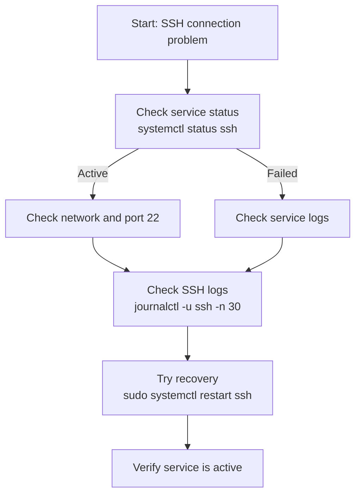

# Linux System Health & SSH Troubleshooting Runbook

## Day 4: Quick Health Snapshot (CPU, Memory, Disk, Network)

### 1. CPU Health
* **`lscpu`** — Shows CPU model, cores, architecture, and processor information.
  ```bash
  lscpu
  ```
* **`top`** — Shows live CPU usage and running processes.
  ```bash
  top
  ```

### 2. Memory Health
* **`free -h`** — Shows total, used, and available RAM.
  ```bash
  free -h
  ```

### 3. Disk Health
* **`df -h`** — Shows disk space and usage percentage.
  ```bash
  df -h
  ```
* **`lsblk`** — Shows available disks and partitions.
  ```bash
  lsblk
  ```

### 4. Network Health
* **`ip addr`** — Shows network interfaces and IP addresses.
  ```bash
  ip addr
  ```
* **`ip route`** — Shows network routing information.
  ```bash
  ip route
  ```
* **`ping -c 4 google.com`** — Checks internet connectivity and packet loss.
  ```bash
  ping -c 4 google.com
  ```

---

## Service Log Tracing (SSH)

* **Check recent SSH logs:**
  ```bash
  sudo journalctl -u ssh -n 30
  ```
* **Check logs from the current boot:**
  ```bash
  sudo journalctl -u ssh -b
  ```
* **Follow live logs:**
  ```bash
  sudo journalctl -u ssh -f
  ```
* **Check SSH service errors:**
  ```bash
  sudo journalctl -u ssh -p err
  ```

### Mini Troubleshooting Flow



---

## Runbook Execution Commands

### A. Environment Basics (2 Commands)
* **Check Linux kernel and system information:**
  ```bash
  uname -a
  ```
* **Check Ubuntu version:**
  ```bash
  cat /etc/os-release
  ```

### B. File System Sanity (2 Commands)
* **Create temporary directory:**
  ```bash
  mkdir -p /tmp/runbook-demo
  ```
* **Copy `/etc/hosts` and verify directory contents:**
  ```bash
  cp /etc/hosts /tmp/runbook-demo/hosts-copy && ls -l /tmp/runbook-demo
  ```

### C. CPU and Memory (2 Commands)
* **Check CPU and running processes:**
  ```bash
  top -bn1 | head -15
  ```
* **Check memory:**
  ```bash
  free -h
  ```

### D. Disk & System Activity (3 Commands)
* **Check disk space:**
  ```bash
  df -h
  ```
* **Check log directory size:**
  ```bash
  sudo du -sh /var/log
  ```
* **Check system activity:**
  ```bash
  vmstat 1 5
